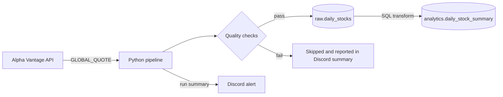

# Stock Data Pipeline

A small data engineering project: it pulls daily US stock quotes from the Alpha Vantage API, validates them, stores them in PostgreSQL, and builds a summary table for analysis. Everything runs in Docker.

## Architecture



1. **Extract** – fetch the latest quote for each ticker (with a timeout, and a delay between calls to respect rate limits).
2. **Validate** – reject bad data before it reaches the database (see below).
3. **Load** – upsert valid rows into `raw.daily_stocks`.
4. **Transform** – compute `daily_change_pct`, `price_range` and `trading_value` into `analytics.daily_stock_summary` with SQL.
5. **Alert** – send a summary (successes and failures) to Discord.

## Project structure

```
main_pipeline.py      # orchestrates the steps above
utils/
  database.py         # connection, table setup, upsert, SQL transform
  quality.py          # data quality checks
  alert.py            # Discord webhook
analytics.sql         # example analysis queries
docker-compose.yml    # Postgres + pipeline containers
```

## How to run

```bash
cp .env.example .env          # then fill in API_KEY, DB_USER, DB_PASS
docker compose up -d postgres
docker compose build pipeline
docker compose run --rm pipeline
docker exec -i stock_postgres psql -U <DB_USER> -d <DB_NAME> < analytics.sql
```

| Variable | Required | Notes |
|---|---|---|
| `API_KEY` | yes | free key from Alpha Vantage |
| `DB_USER`, `DB_PASS` | yes | no defaults in the code |
| `DB_NAME` | no | defaults to `stock_db` |
| `DISCORD_WEBHOOK_URL` | no | alerts are skipped if empty |

## Design decisions

- **Two schemas (`raw` and `analytics`).** Raw data is stored as received; the analytics table is derived from it with SQL, so it can always be rebuilt.
- **Idempotent loads.** Both tables use `ON CONFLICT (symbol, latest_trading_day) DO UPDATE`, so re-running the pipeline never creates duplicate rows.
- **Data quality checks before loading.** A row is rejected if a field is missing or non-numeric, a price is not positive, high < low, volume is negative, or the price moved more than 50% from the previous close (possible split or bad data).
- **One bad ticker never stops the run.** Each ticker is processed in its own `try/except`; failures are collected and reported.
- **Secrets stay out of the code.** Keys and passwords come from environment variables, and error messages are written so the API key (which is part of the request URL) is never printed.
- **`daily_change_pct` is measured against the previous close**, which matches how stock sites report daily change.

## Known limitations

- The free Alpha Vantage plan allows 25 requests/day and 5 requests/minute, so the pipeline tracks 10 tickers and waits 12 seconds between calls.
- `GLOBAL_QUOTE` returns only the latest trading day, so history builds up one day per run.
- `trading_value` is an estimate (`price * volume`).
- The SQL transform rebuilds from the whole raw table on every run. That is fine at this size; a larger dataset would need an incremental version.

## Example output

<!-- Paste a screenshot or the result of analytics.sql from your own run here -->

## Next steps

- Schedule the pipeline daily with Airflow.
- Backfill historical prices.
- Add a dashboard on top of `analytics.daily_stock_summary`.