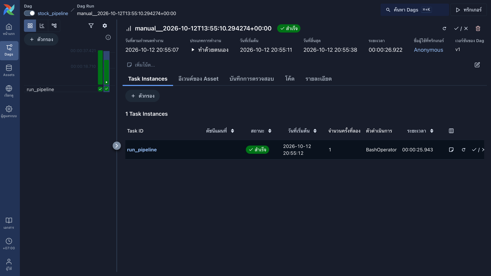

# US Stock Data Pipeline

Every weekday after the US market closes, Airflow runs a Python script that downloads daily prices for 20 US stocks from yfinance, checks the data, and loads it into PostgreSQL as a star schema. Everything runs in Docker Compose. I built it to practice the basics of data engineering: pulling data from an API, cleaning it, modeling it, scheduling it, and making reruns safe.



## How it works

```
Airflow (weekdays, 17:00 New York time) runs main_pipeline.py:

  yfinance
     │
     ▼
  Data quality checks   (missing values, non-positive prices, high < low, negative volume)
     │
     ▼
  raw.stock_prices      (upsert on ticker + trade_date)
     │
     ▼
  SQL transform         (daily change % using LAG)
     │
     ▼
  analytics.fact_stock_prices  +  analytics.dim_stock (sector info)

Discord gets a message when a run starts and a summary when it ends.
```

- **Reruns are safe** Both tables use `ON CONFLICT (ticker, trade_date) DO UPDATE`, so a second run never creates duplicate rows.
- **One bad ticker does not stop the run** Each ticker has its own `try/except`. Failures and the number of rejected rows show up in the Discord summary, and Airflow retries a failed run twice.
- **Secrets stay out of the code** The database login comes from `.env`, which is git-ignored.

The star schema is `dim_stock` (ticker, company, sector, sub-industry, loaded from `data/stocks.csv`) and `fact_stock_prices` (ticker, trade date, open/high/low/close, volume, daily change % versus the previous close). Example queries are in `analytics.sql`.

## Run it

You need Docker and Git.

```bash
git clone https://github.com/dxkillmy/us-stock-data-pipeline
cd us-stock-data-pipeline
cp .env.example .env      

docker compose up -d postgres
PERIOD=1y docker compose run --rm pipeline 
docker exec -i stock_postgres psql -U root -d stock_db < analytics.sql

docker compose up -d airflow
```

The Airflow login is turned off, so only use it on your own machine. Run the pipeline by hand any time with `docker compose run --rm pipeline`. After changing the Python code, rebuild with `docker compose build`.

## What I ran into

- The free Alpha Vantage key only allows 25 requests per day, which is too few for many tickers, so I switched to yfinance.
- My first "daily change" compared the price with the day's open. It did not match stock sites, so I changed it to compare with the previous close.
- After I changed the code, the container kept running the old version until I rebuilt the image.
- `CREATE TABLE IF NOT EXISTS` does not change a table that already exists, so when I added a column I dropped and recreated the schemas (fine in development, not with real data).

## Limitations

- yfinance is an unofficial library meant for personal and learning use. It can change or be rate limited.
- Only 20 tickers. The sector labels in `data/stocks.csv` were typed by hand and may not match the latest GICS names.
- Airflow runs in `standalone` mode, which is meant for learning and small setups. It only runs while Docker is running on the machine.
- If the pipeline runs while the market is open, the latest row is a partial-day price until the next run replaces it.
- Tests cover the data quality checks only, not the database code.